# Klasifikasi Citra Dokumen Hasil Scan

Tugas 2 Supervised Machine Learning: klasifikasi 16 jenis dokumen bisnis dari gambar hasil scan (subset RVL-CDIP) menggunakan PyTorch. Prediksi dikumpulkan pada kompetisi Kaggle [Document Image Classification](https://www.kaggle.com/competitions/document-image-classification-sd234504) dengan metrik accuracy.

**Hasil akhir:** ensemble dua ConvNeXt-Tiny dengan akurasi validation **0,8924**.

---

## Daftar Isi
1. [Struktur Repository](#struktur-repository)
2. [Dataset](#dataset)
3. [Cara Penggunaan](#cara-penggunaan)
4. [Alur Analisis](#alur-analisis)
5. [Laporan Interpretasi](#laporan-interpretasi)
6. [Kesimpulan](#kesimpulan)

---

## Struktur Repository

```
document-image-classification/
├── configs/
│   ├── baseline.yaml          # eksperimen 1: ResNet-18, 224x224
│   ├── convnext_384.yaml      # eksperimen 2: ConvNeXt-Tiny, 384x384
│   └── config.yaml            # eksperimen 3: ConvNeXt-Tiny, 512x384
├── data/                      # dataset (tidak di-upload, lihat bagian Dataset)
├── checkpoint/                # bobot model hasil training (tidak di-upload)
├── notebooks/
│   ├── 01_eda.ipynb           # eksplorasi data
│   ├── 02_training.ipynb      # training, perbandingan eksperimen, submission (Kaggle GPU)
│   └── 03_evaluation.ipynb    # evaluasi per kelas, confusion matrix, Grad-CAM (CPU)
├── src/
│   ├── dataset.py             # pembacaan metadata, pembersihan data, split, Dataset PyTorch
│   ├── transforms.py          # resize dan augmentasi
│   ├── model.py               # pembuatan dan pemuatan model
│   ├── train.py               # loop training dan validasi
│   ├── evaluate.py            # prediksi dan metrik
│   ├── predict.py             # pembuatan file submission
│   ├── gradcam.py             # visualisasi Grad-CAM
│   └── utils.py               # seed, konfigurasi, plot
├── results/
│   ├── figures/               # seluruh grafik
│   ├── metrics/               # tabel metrik, riwayat training, prediksi validation
│   └── submissions/           # file submission Kaggle
├── requirements.txt
└── README.md
```

---

## Dataset

Data berasal dari subset [RVL-CDIP](https://adamharley.com/rvl-cdip/): 32.003 gambar train dan 7.994 gambar test dalam format `.tif` grayscale.

| ID | Kelas | ID | Kelas |
|---|---|---|---|
| 0 | advertisement | 8 | memo |
| 1 | budget | 9 | news_article |
| 2 | email | 10 | presentation |
| 3 | file_folder | 11 | questionnaire |
| 4 | form | 12 | resume |
| 5 | handwritten | 13 | scientific_publication |
| 6 | invoice | 14 | scientific_report |
| 7 | letter | 15 | specification |

### Cara mengunduh

**Melalui website:** buka halaman kompetisi → tab **Data** → **Download All**, lalu ekstrak ke folder `data/`.

**Melalui Kaggle API:**
```bash
pip install kaggle
kaggle competitions download -c document-image-classification-sd234504
unzip document-image-classification-sd234504.zip -d data
```

Struktur folder setelah diekstrak:
```
data/
├── train/train/<nama_kelas>/*.tif
├── test/test/*.tif
├── train.csv
├── test.csv
└── sample_submission.csv
```

---

## Cara Penggunaan

### 1. Instalasi
```bash
git clone https://github.com/Violita-archive/document-image-classification.git
cd document-image-classification
pip install -r requirements.txt
```

### 2. Menjalankan di Kaggle (disarankan, membutuhkan GPU)
1. Buat notebook baru dari halaman kompetisi (dataset otomatis ter-attach).
2. **File → Import Notebook → GitHub**, pilih `notebooks/02_training.ipynb`.
3. **Settings**: Accelerator **GPU T4**, Internet **On**.
4. **Save Version → Save & Run All**. Cell pertama otomatis meng-clone repository ini.
5. Hasil (`results/` dan `checkpoint/`) tersedia di tab **Output** sebagai `hasil_training.zip`.

Total waktu ±3 jam pada GPU T4.

### 3. Menjalankan dari terminal
```bash
# training satu eksperimen
python -m src.train --config configs/config.yaml --name convnext_tiny_512

# membuat submission dari checkpoint
python -m src.predict --checkpoint checkpoint/convnext_tiny_512_best.pth --output results/submissions/submission.csv
```
Path data diatur pada `data_dir` di file konfigurasi. Di Kaggle, folder `/kaggle/input` dicari otomatis.

### 4. Evaluasi
Setelah `results/` dan `checkpoint/` tersedia, jalankan `notebooks/03_evaluation.ipynb`. Notebook ini tidak membutuhkan GPU.

### Bobot model
Folder `checkpoint/` tidak di-upload karena ukurannya melebihi batas GitHub. Bobot model dapat diunduh di: *[tautan Google Drive]*

---

## Alur Analisis

```
EDA (01) → pembersihan data → split stratified 90/10 → training 3 eksperimen (02)
        → ensemble → submission Kaggle → evaluasi per kelas dan Grad-CAM (03)
```

---

## Laporan Interpretasi

### 1. Temuan EDA

| Aspek | Temuan |
|---|---|
| Jumlah data | 32.003 train, 7.994 test, 16 kelas |
| Distribusi kelas | 1.948 – 2.056 per kelas (rasio 1,06), seimbang |
| Format gambar | grayscale 8-bit, tinggi 1.000 px, lebar median 762 px, 99,9% portrait |
| Kualitas | 1 file rusak, 11 grup gambar identik (3 grup berlabel berbeda) |
| Train vs test | distribusi serupa (KS maksimum 0,032) |

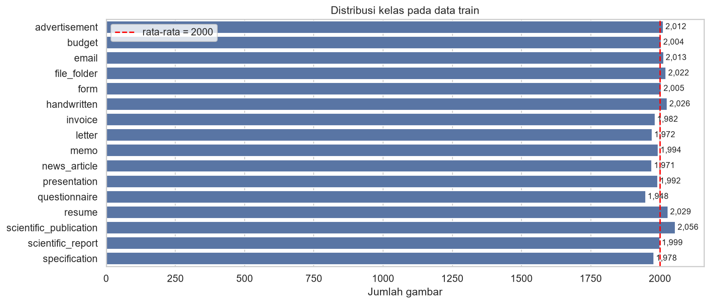

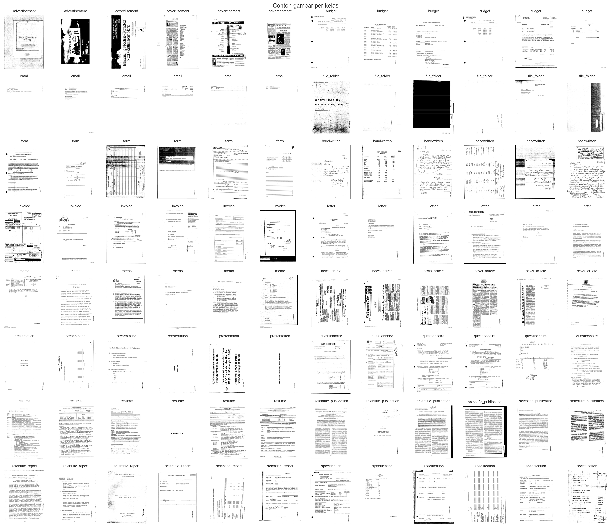

Citra rata-rata tiap kelas menunjukkan pola tata letak yang berbeda, misalnya blok header pada email dan dua kolom pada scientific_publication. Meski begitu, proyeksi t-SNE dari piksel mentah memperlihatkan sebagian besar kelas saling tumpang tindih. Hanya email, file_folder, dan specification yang membentuk kelompok jelas. Hal ini menunjukkan bahwa diperlukan model yang mampu mempelajari pola tata letak dan teks, bukan sekadar intensitas piksel.

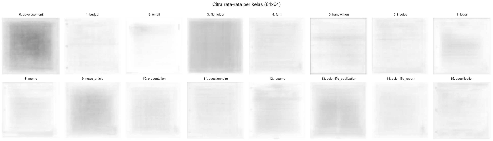

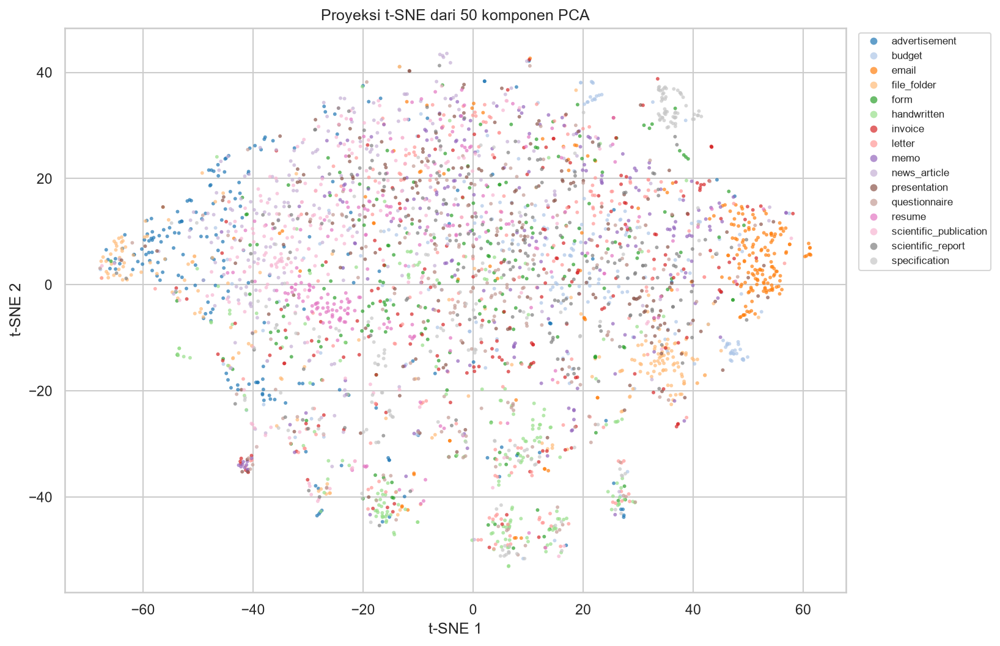

Analisis lengkap ada di [`01_eda.ipynb`](notebooks/01_eda.ipynb).

### 2. Preprocessing

| Langkah | Alasan |
|---|---|
| Membuang 1 file rusak dan 43 file dari grup identik berlabel berbeda | gambar yang sama dengan label berbeda memberi sinyal yang saling bertentangan |
| Menyisakan satu file dari duplikat berlabel sama (8 file dibuang) | mencegah gambar yang sama masuk ke train dan validation sekaligus |
| Split stratified 90/10 (28.755 train, 3.196 validation) | proporsi kelas tetap sama |
| Grayscale → 3 kanal, normalisasi ImageNet | sesuai bobot pre-trained |
| Resize 224, 384, atau 512x384 | lihat bagian eksperimen |
| Augmentasi: rotasi ±3°, translasi 3%, skala 0,95–1,05, kecerahan/kontras ±20% | meniru variasi hasil scan |
| Tanpa flip | dokumen terbalik tidak realistis |

### 3. Eksperimen

Seluruh model memakai bobot pre-trained ImageNet dari `timm`, optimizer AdamW, warmup 1 epoch lalu cosine decay, mixed precision, dan menyimpan checkpoint dengan akurasi validation tertinggi.

| Eksperimen | Model | Input | Epoch terbaik | Train acc | Val acc | Selisih | Waktu |
|---|---|---|---|---|---|---|---|
| 1 | ResNet-18 | 224x224 | 5 / 5 | 0,8565 | 0,8285 | 0,028 | 12 menit |
| 2 | ConvNeXt-Tiny | 384x384 | 9 / 10 | 0,9914 | 0,8867 | 0,105 | 67 menit |
| 3 | ConvNeXt-Tiny + drop path 0,2 | 512x384 | 11 / 12 | 0,9791 | 0,8833 | 0,096 | 109 menit |
| **Ensemble** | rata-rata probabilitas 2 + 3 | - | - | - | **0,8924** | - | - |

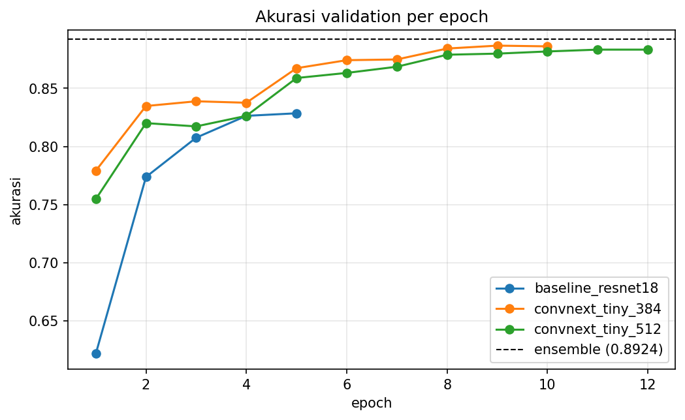

**Interpretasi:**
- **ResNet-18 → ConvNeXt-Tiny 384** menaikkan akurasi validation sebesar 5,8 poin. Resolusi yang lebih tinggi mempertahankan detail teks dan tata letak, dan arsitektur ConvNeXt lebih kuat.
- **Overfitting.** Pada eksperimen 2, akurasi train mencapai 99% sedangkan validation 89%. Kurva val loss tetap menurun hingga akhir, jadi model tidak memburuk, tetapi kapasitasnya jauh melebihi data yang tersedia.
- **Eksperimen 3** menurunkan selisih train–validation dari 0,105 menjadi 0,096 dengan stochastic depth dan input yang mengikuti rasio halaman, tetapi akurasi validation-nya tidak lebih tinggi dari eksperimen 2 (0,8833 vs 0,8867). Resolusi tambahan dan regularisasi tidak memberi kenaikan yang berarti.
- **Ensemble.** Prediksi eksperimen 2 dan 3 berbeda pada 7,4% data validation, sehingga penggabungan keduanya menaikkan akurasi menjadi 0,8924 (+0,6 poin dari model tunggal terbaik).

<table>
<tr>
<td>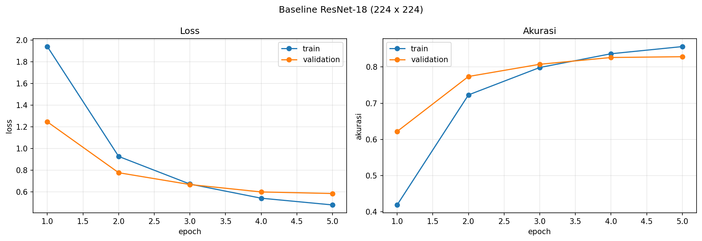</td>
<td>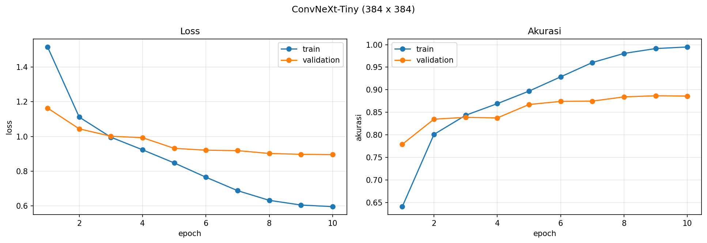</td>
</tr>
<tr>
<td colspan="2">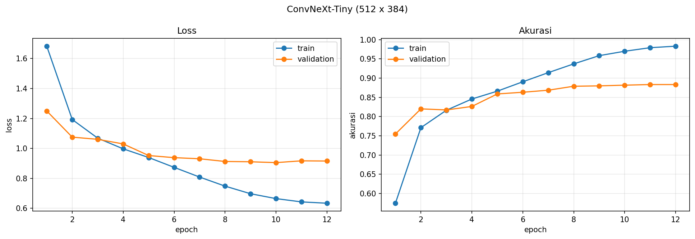</td>
</tr>
</table>

### 4. Evaluasi per kelas

*(diisi dari `03_evaluation.ipynb`)*

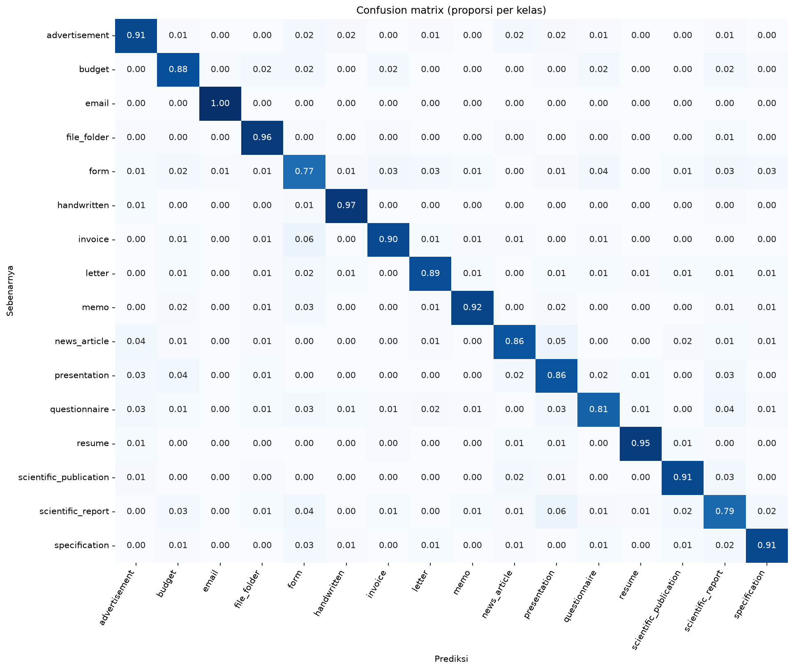

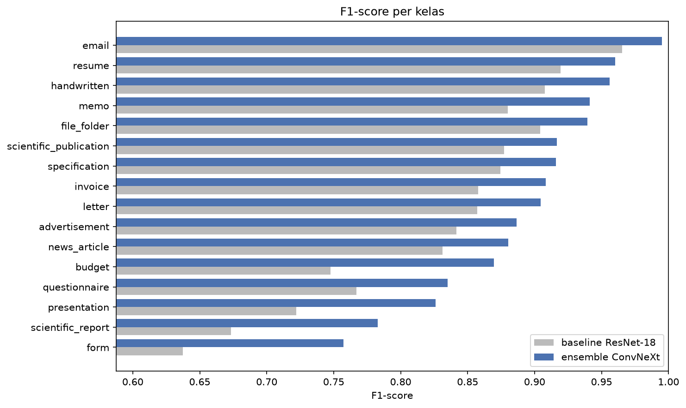

### 5. Analisis kesalahan

*(diisi dari `03_evaluation.ipynb`)*

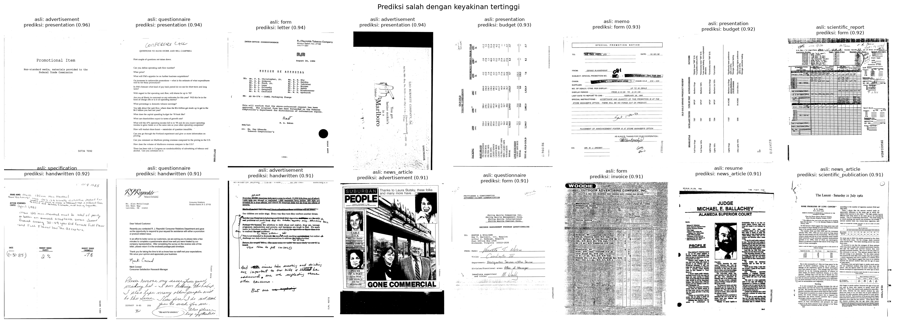

### 6. Grad-CAM

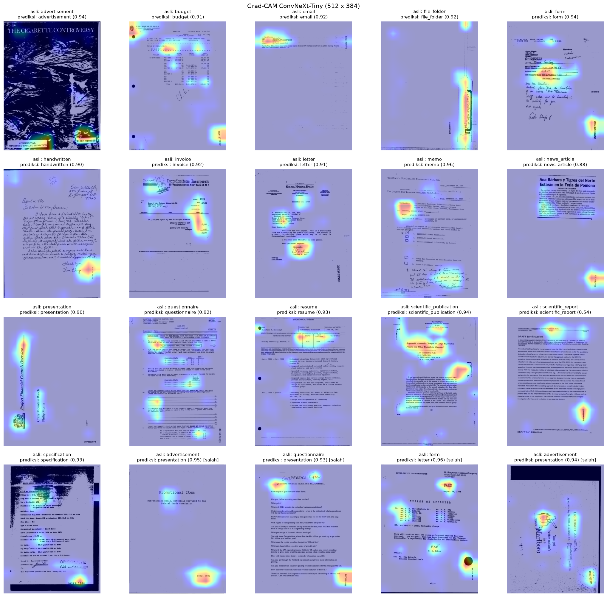

### 7. Skor Kaggle

| Submission | Val acc | Public | Private |
|---|---|---|---|
| baseline_resnet18 | 0,8285 | 0,81472 | |
| convnext_tiny_384 | 0,8867 | 0,87703 | |
| convnext_tiny_512 | 0,8833 | | |
| **ensemble** (final) | **0,8924** | | |

Skor public sekitar 1 poin di bawah akurasi validation, konsisten dengan hasil EDA yang menunjukkan distribusi train dan test serupa.

---

## Kesimpulan

1. Data relatif bersih dan seimbang. Masalah utamanya adalah sejumlah kecil gambar identik berlabel berbeda, yang dibuang sebelum training.
2. Fine-tuning CNN pre-trained bekerja jauh lebih baik dibanding fitur piksel sederhana. ConvNeXt-Tiny pada resolusi 384 memberi akurasi validation 0,8867, naik 5,8 poin dari baseline ResNet-18.
3. Model cenderung overfitting. Regularisasi tambahan sedikit mengurangi selisih train–validation, tetapi tidak menaikkan akurasi.
4. Ensemble dua model dengan ukuran input berbeda memberi hasil terbaik, yaitu 0,8924 pada validation.

**Keterbatasan dan saran**
- Hanya satu split validation yang digunakan. Cross-validation akan memberi estimasi yang lebih stabil, tetapi membutuhkan waktu GPU beberapa kali lipat.
- Model hanya memakai informasi visual. Pada RVL-CDIP, model yang juga membaca teks (OCR) atau model yang di-pre-train pada dokumen umumnya mencapai akurasi lebih tinggi.
- Model akhir dapat dilatih ulang pada seluruh data train (tanpa menyisihkan validation) untuk memanfaatkan 10% data tambahan.

---

## Author

*Nama* — *NRP*
Departemen Statistika, Institut Teknologi Sepuluh Nopember
